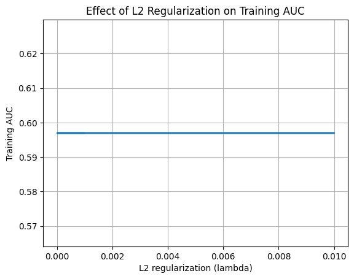

# Project 1 — Designing Lung Cancer Screening Programs with Machine Learning

Predict lung cancer risk from PLCO (Prostate, Lung, Colorectal and Ovarian) screening-trial questionnaires, then simulate how a risk-model-based screening rule compares with the current **NLST** eligibility criteria.

**Highlights**
- Logistic regression with mini-batch SGD and L2 regularization, **implemented from scratch in NumPy** (no sklearn model).
- Custom `Vectorizer` for numerical (z-score + missing flag), categorical (one-hot + `__MISSING__`) and ordinal (integer + mode imputation + missing flag) features.
- Multiprocessing **grid-search dispatcher** that launches `main.py` per configuration and aggregates results to CSV.
- Clinical-utility analysis against NLST: sensitivity, specificity, PPV, matched-specificity comparison, subgroup metrics.

## Results

| Metric | Value |
|---|---|
| Age-only model training AUC (course reference ≈ 0.60) | 0.597, flat across λ ∈ [0, 0.01] |
| Full model validation AUC (best grid config) | **0.833** |
| Full model **test** AUC | **0.816** |
| Split | 100,000 train / 25,000 validation / 29,887 test (seed 0) |

**Grid search (36 configs):** learning rate {0.01, 0.001, 0.0001} × batch size {32, 64} × epochs {10, 20} × λ {0, 0.001, 0.01}. Best validation AUC **0.8327** at lr = 0.01, batch = 32, epochs = 20, λ = 0.001 (`results/grid_results.csv`). Learning rate dominated: lr = 0.01 → val AUC 0.80–0.83; lr = 0.001 → 0.69–0.79; lr = 0.0001 → 0.60–0.64 (under-trained in ≤20 epochs). L2 strength had little effect in the tested range.



### Clinical utility vs. NLST (test set)

| | Sensitivity | Specificity | PPV |
|---|---|---|---|
| NLST criteria | 0.667 | 0.803 | 0.075 |
| Model @ NLST-matched specificity (threshold 0.0343) | **0.695** | 0.803 | — |

The operating threshold was chosen to reach 80% sensitivity, reflecting the clinical priority of minimizing missed cancers (a false negative delays treatment; a false positive leads to follow-up imaging).

### Top model features (standardized weights)
1. `age` (+0.64 → odds ×1.89 per +1 SD)
2. `pack_years` (+0.53 → odds ×1.69 per +1 SD)
3. `smoked_f = never` (−0.68 → odds ×0.51)

### Subgroup AUC (test)
| Group | AUC |
|---|---|
| Female / Male | 0.834 / 0.796 |
| White / Black / Hispanic / Asian | 0.827 / 0.790 / 0.749 / 0.807 |
| Pacific Islander / American Indian (very small *n*) | 0.889 / 0.542 |
| Education: <8 yrs → college grad | 0.731 → 0.849 |
| Never / Current / Former smoker | 0.648 / 0.637 / 0.753 |
| NLST-ineligible / eligible | 0.782 / 0.640 |

Full discussion — including differences > 0.05, class imbalance, small-subgroup instability and study-design limitations — is in [`report/CPHC100_Project_1_Writeup.pdf`](report/CPHC100_Project_1_Writeup.pdf).

## Code overview

| File | Purpose |
|---|---|
| `logistic_regression.py` | `fit` (shuffled mini-batch SGD), `gradient` (BCE + L2), `predict_proba`, `predict` |
| `vectorizer.py` | `Vectorizer.fit/transform` for the three feature types; robust missing-value parsing |
| `dispatcher.py` | `itertools.product` job expansion, worker pool via `multiprocessing`, subprocess per run, CSV aggregation |
| `main.py` | Loads PLCO CSV, splits data, vectorizes, trains, reports train/val AUC |
| `grid_search.json` | Hyperparameter grid |

Feature configuration used (`main.py`):
```python
feature_config = {
    "numerical":   ["age", "pack_years"],
    "categorical": ["sex", "race7", "smoked_f", "lung_fh", "marital"],
    "ordinal":     ["educat", "agelevel"],
}
```

## Reproduce

```bash
conda create -n cph100_project1 python=3.10 -y && conda activate cph100_project1
pip install -r requirements.txt
python check_installation.py
# place PLCO extract at ./lung_prsn.csv (see ../docs/DATA_ACCESS.md)
python main.py --learning_rate 0.01 --batch_size 32 --num_epochs 20 --regularization_lambda 0.001
python dispatcher.py --config_path grid_search.json --num_workers 4
```

## Notes
- The test-set analyses (ROC/PR curves, subgroup AUCs, NLST comparison) are documented in the report; `main.py` keeps the test-AUC lines commented so the test set is only used for final evaluation.
- Data are not included (see `../docs/DATA_ACCESS.md`).
- Team report authors: Jake Pastoria, Asli Alpman, Majed AlFaraj, Viraj Gupta.
