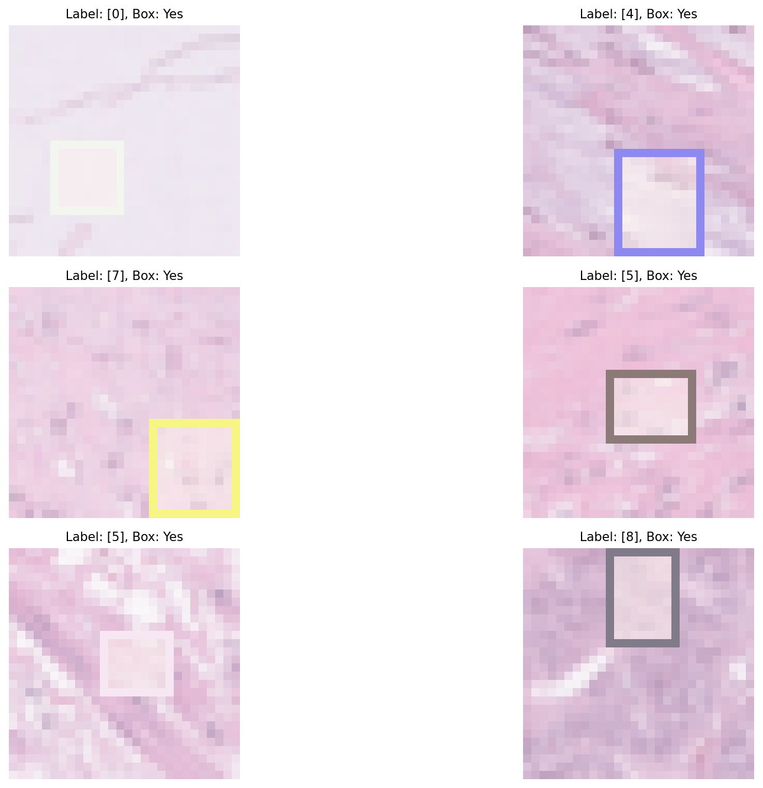
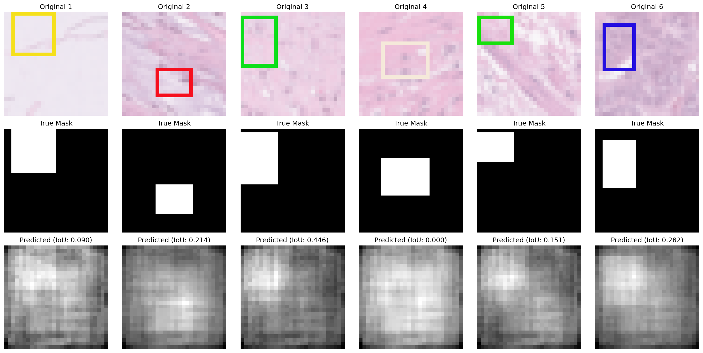
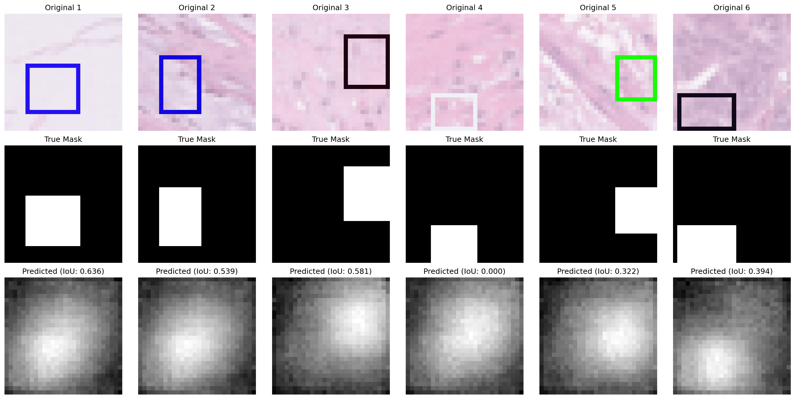
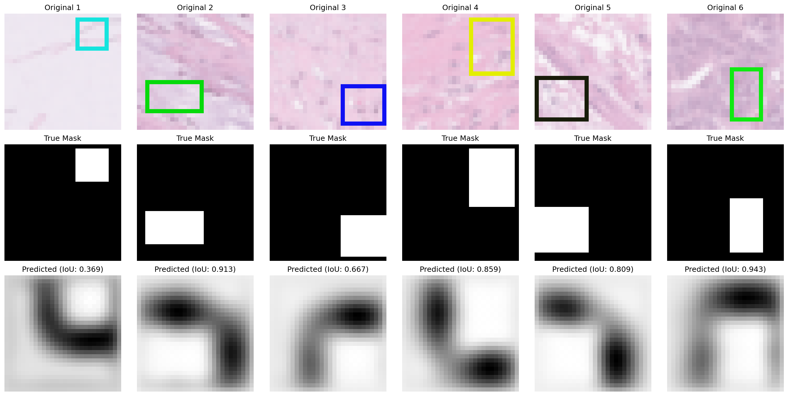
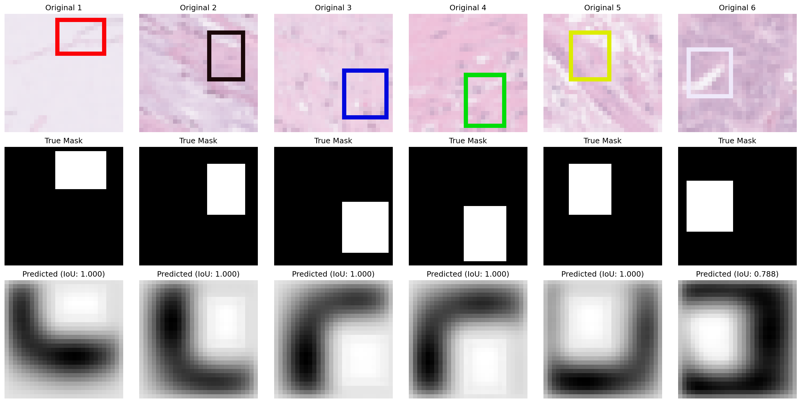

# Project 2 — Medical Imaging Tools with Deep Learning (PathMNIST)

PyTorch implementations of the building blocks behind modern medical-imaging systems, using the miniature histopathology dataset **PathMNIST** (28×28 RGB colorectal tissue patches, 9 classes):

1. **Classification** — Linear → MLP → CNN
2. **Segmentation / localization** — Linear → MLP → encoder–decoder CNN → **U-Net with skip connections**, trained on synthetic colored boxes drawn onto PathMNIST patches

## Architectures

### Classification (`classification_models.py`)
| Model | Design |
|---|---|
| `LinearModel` | Flatten (2352) → Linear(9); equivalent to multinomial logistic regression on pixels |
| `MLPModel` | 2352 → 512 → 256 → 9, ReLU, dropout 0.4 |
| `CNNModel` | 4 × [Conv3×3 → BatchNorm → ReLU → MaxPool] with 32/64/128/256 channels → AdaptiveAvgPool(2×2) → FC 256 (dropout 0.5) → FC 9 |

Training (`classification_train.py`): AdamW (lr 5e-4, weight decay 1e-4), cross-entropy loss, 40 epochs by default, batch size 32.

### Segmentation (`segmentation_models.py`)
| Model | Design |
|---|---|
| `LinearSegmentation` | Flatten → Linear → reshape to 28×28 mask |
| `MLPSegmentation` | 2352 → 1024 → 512 → 784 |
| `SimpleCNNSegmentation` | Encoder–decoder (64/128/256 channels, 2 downsamples, transposed-conv upsampling), **no skip connections** |
| `TinyUNet` | Same depth, **with skip connections** (concatenated encoder features at each decoder stage) |

Loss: `CombinedLoss` = 0.1 × BCE-with-logits + 0.9 × Dice. Optimizer: Adam (lr 1e-3), 30 epochs by default. Metric: per-image IoU (`calculate_iou`).

**Task:** `synthetic_data.py` overlays a 1-pixel randomly colored rectangular border (8–14 px sides, random position) on each PathMNIST patch; the target mask is the *interior* of the box. Solving this requires finding the border and filling the region it encloses — a controlled test of spatial reasoning.



## Qualitative results

Predictions on the same six training images for each architecture (top row: input; middle: ground truth; bottom: model output with per-image IoU in the title):

| Model | Per-image IoU on the 6 sample images |
|---|---|
| Linear | 0.00 – 0.45 (diffuse, no localization) |
| MLP | 0.00 – 0.64 (blurry blob near the right area) |
| Simple CNN (no skips) | 0.37 – 0.94 |
| **U-Net (skips)** | **1.00 on 5 of 6, 0.79 on the other** |

Skip connections let the decoder reuse high-resolution border information from the encoder, which is what makes sharp, box-shaped masks possible; the no-skip CNN recovers the right area but with blurrier edges.

| Linear | MLP |
|---|---|
|  |  |
| **CNN (no skips)** | **U-Net** |
|  |  |

> These are qualitative examples from six images, not aggregate metrics. Course targets were >90% classification accuracy and >95–97% segmentation IoU; add your full-run validation numbers (printed at the end of `classification_main.py` / `segmentation_main.py`) to this section.

## Reproduce

```bash
conda create -n cph100_project2 python=3.10 -y && conda activate cph100_project2
pip install -r requirements.txt
python check_installation.py

# Classification (PathMNIST downloads automatically to ./data)
python classification_main.py --model_name cnn --learning_rate 5e-4 --num_epochs 40

# Segmentation
python segmentation_main.py --model_name unet --learning_rate 1e-3 --num_epochs 30
```

Runs on CPU or GPU (auto-detected). Figures are written to `visualizations/`.

## Files
| File | Purpose |
|---|---|
| `classification_models.py`, `classification_train.py`, `classification_main.py` | Classifiers, training/validation loops, driver |
| `segmentation_models.py`, `segmentation_train.py`, `segmentation_main.py` | Segmentation models, Dice/BCE loss, IoU, training loops, driver |
| `classification_dataset.py`, `synthetic_data.py`, `metrics.py` | Course-provided data loading, box generation, accuracy metric |
| `visualizations/` | Sample boxes and each model's predictions |

## Attribution
Starter scaffolding and data utilities: CPH 100A course release. Model architectures, loss functions and training loops are the student implementations. Dataset: PathMNIST from MedMNIST v2 (Yang et al., *Sci Data* 2023), derived from Kather et al. (2019) colorectal histology images.
